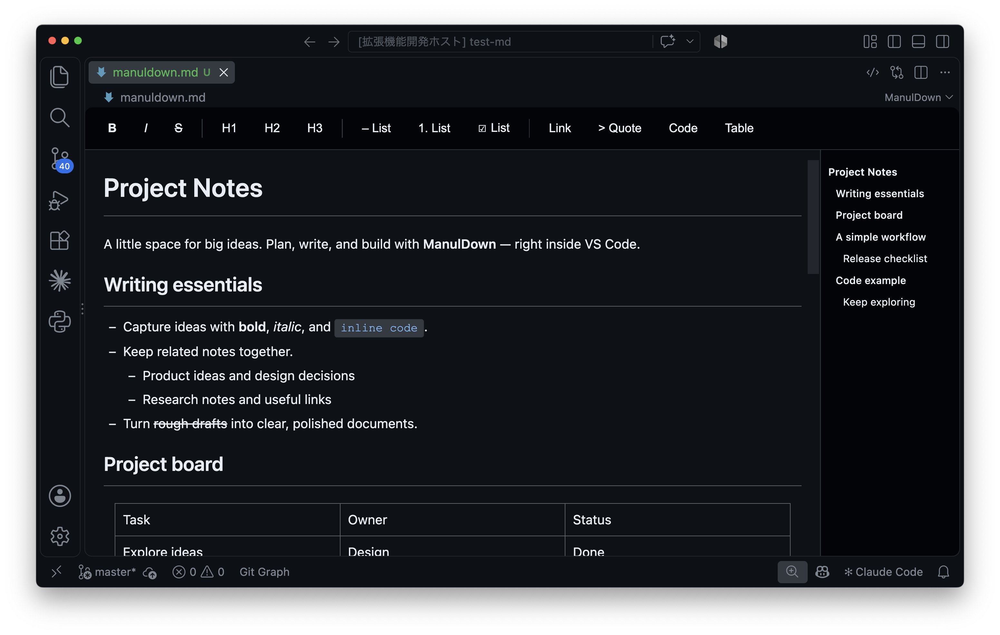

[English](./README.md) / [日本語](./README.ja.md)

# ManulDown for VSCode

ManulDownは、Markdownの表示結果を見ながら編集できるVSCode拡張機能です。変更はMarkdownファイルに反映されます。



## 主な機能

- 見出し、文字装飾、リスト・タスクリスト、表のWYSIWYG編集
- 画像の貼り付け・ドラッグ＆ドロップと、文書移動時の画像の追随
- URL・ワークスペース内ファイルへのリンク、脚注、自動目次
- シンタックスハイライト付きコードブロック、TeX数式、Mermaid図
- Markdown記法の自動変換、検索、Undo/Redo
- 高コントラストを含むVSCodeテーマへの追従

## 使い方

1. Markdownファイル（`.md`）を開きます。
2. コマンドパレットから **ManulDown: Open with ManulDown Editor** を実行します。

エクスプローラーでファイルを右クリックし、**Open With… → ManulDown** から開くこともできます。

### 基本的な編集

ツールバーから書式の変更や要素の挿入ができます。幅に収まらないボタンは **…** メニューに表示します。

| ボタン | 操作 |
| --- | --- |
| **B** / **I** / **&lt;/&gt;** | 太字・斜体・インラインコードを切り替え |
| **H1, H2, H3** | 見出しレベルを変更 |
| **• / 1. / ☑** | 箇条書き・番号付きリスト・タスクリストに切り替え |
| **Link** | リンクを挿入・編集 |
| **Footnote** | 脚注を追加 |
| **Code** | コードブロックを挿入 |
| **Math** / **Math Block**（**…** 内） | インライン数式・数式ブロックを挿入 |
| **Image** | 画像ファイルを取り込んで挿入 |

`# 見出し`、`**太字**`、`*斜体*`、`- 項目`、`1. 項目` などのMarkdown記法も入力中に変換します。コードブロックは `` ```javascript `` のように言語を指定して `Enter` で作成できます。

### リンク

テキストを選択し、**Link**、`/link`、または `Cmd+K` / `Ctrl+K` で入力欄を開きます。URL（HTTP・HTTPS・`mailto:`）、ワークスペース内の絶対パス、`./` / `../` で始まる相対パスを入力し、**Apply** または `Enter` で確定します。2文字以上入力するとファイル候補を検索できます。

ワークスペース内のファイルは相対リンクとして保存します。選択したテキストへ絶対パスを直接貼り付けてもリンクを作成できます。無効なパスやワークスペース外のパスは通常のテキストとして貼り付けます。

リンクは `Cmd+Click` / `Ctrl+Click`、またはリンク内で `Cmd+Enter` / `Ctrl+Enter` を押すと開きます。

### 脚注

**Footnote** または `/footnote` で追加し、文書末尾の注釈を直接編集できます。Markdownの `[^ラベル]` と `[^ラベル]: 注釈` に対応し、画面上では本文の参照順に並びます。

- **移動**: 本文の参照番号をクリックすると注釈へ、注釈の「↩」で本文へ戻ります。キーボードでは `Tab` や `←` / `→` で番号を選び、`Enter` で移動できます。
- **注釈ごと削除**: 注釈にマウスを合わせて「×」を押すか、注釈一覧の番号を選んで `Backspace` を押すと、対応する参照もまとめて削除します。
- **参照だけ削除**: 本文の参照番号を `Backspace` / `Delete` で消します。最後の参照を消すと、対応する注釈も削除します。

本文をコピー・移動すると、対応する注釈も保持されます。

### 画像と文書の移動

画像は貼り付け、ドラッグ＆ドロップ、**Image** ボタンから取り込めます。保存先はMarkdownと同じフォルダの `images/<文書名（拡張子なし）>/` です。

VSCode内で `.md` を移動・名前変更すると、そのフォルダ内の使用中の画像も追随し、リンクを更新します。例えば `docs/memo.md` → `archive/notes.md` なら、画像は `docs/images/memo/` → `archive/images/notes/` へ移動します。

- 他のMarkdownと共有する画像はコピーし、未使用の画像は元に残します。
- 同名ファイルには連番を付け、空になった画像フォルダは削除します。文書と画像の移動はまとめてUndo/Redoできます。
- 自動移動を無効にするには、`manulDown.images.moveWithDocument` を `false` にします。

画像の追随には、移動元・移動先がともに信頼済みワークスペース内にあり、`markdown.updateLinksOnFileMove.enabled` が `never` であることが必要です。`always` / `prompt` ではVSCode標準機能にリンク更新を任せ、画像を元に残します。VSCode外での移動には追従しません。

画像の端で `←` / `→` を押して画像を選択すると、`Shift+↑` / `Shift+↓` で拡大・縮小できます。HTML内のローカルファイルURLからの画像取り込みや、画像保存先のシンボリックリンクには対応していません。

### コピー

- **Copy as Markdown**: 選択範囲を右クリックして実行すると、書式・リンク・画像・脚注を含むMarkdownとしてコピーします。`Cmd+Shift+C` / `Ctrl+Shift+C` でも実行できます。
- **通常のコピー**: 画像単体はPNG、文章と画像や複数画像の選択範囲は画像を埋め込んだHTMLとしてコピーします。貼り付け先のHTML対応が必要で、複数画像を別々の添付ファイルとしては渡せません。アニメーションは静止画になります。

読み込めない画像などは、警告を表示して画像の参照とテキストをコピーします。

### 数式

TeXの数式を[KaTeX](https://katex.org/supported.html)で表示します。

- **インライン数式**: `$E = mc^2$` のように、区切りの `$` の内側に空白を置かず入力します。クリックまたは選択後の `Enter` で編集し、`Enter` で確定、`Esc` でキャンセルします。
- **数式ブロック**: 空行で `$$` を入力して `Enter` を押すか、`/math` または **Math Block** を使います。**Preview** スイッチでTeXの編集と数式表示を切り替えます。

```` ```math ```` のコードブロックにも対応しています。変更していない数式は元の記法を保持します。

### Mermaid図

言語を `mermaid` にしたコードブロックを作成し、**Preview** スイッチでソースと図を切り替えます。コピーアイコンでソースをコピー、ダウンロードアイコンでPNG／SVGを保存できます。

拡大アイコンで図をエディタ領域いっぱいに表示します。ホイールでズーム、ドラッグや矢印キーで移動し、**Fit** で全体表示、`Esc` で閉じます。

### Markdown原文の保持

ファイルを開くだけでは原文を変更しません。編集時も、未変更のブロックやインライン書式、表の空白、空行などは元の記法を保持します。

フロントマター、raw HTML、参照定義も原文を保持します。`[!NOTE]` などのGitHubアラートのマーカーは、読み取り専用の原文として表示します。

### スラッシュコマンド

行頭または空白の後に `/` を入力すると挿入メニューを開きます。文字の直後では `Control+/`（macOS）/ `Alt+/`（Windows/Linux）を使えます。文字を入力して候補を絞り、矢印キーや `Tab` で選択、`Enter` で実行、`Esc` でキャンセルします。

| コマンド | 操作 |
| --- | --- |
| `/link` | リンクを挿入 |
| `/toc` | 見出しへのリンクを階層付きリストとして挿入 |
| `/footnote` | 脚注を追加し、注釈を編集 |
| `/table` | 2×2の表を挿入 |
| `/quote` | 引用に変換・挿入 |
| `/code` | コードブロックを挿入 |
| `/math` | 数式ブロックを挿入 |
| `/inline-math` | インライン数式を挿入 |
| `/checkbox` | タスクリストを作成 |
| `/settings` | ManulDownの設定を開く |

`/toc` で挿入した目次は自動更新されません。見出し変更後は再度挿入してください。スラッシュメニューはコードブロック内、表のセル内、IME変換中には表示しません。

`~/.manuldown/meeting-minutes.md` のようにファイルを置くと、`/meeting-minutes` で内容を挿入できます。カスタムコマンドは緑色で表示します。名前の空白は `-` に、英字は小文字に変換し、組み込みコマンドや他のファイルと名前が重複するものは無視します。

### キーボードショートカット

| 操作 | macOS | Windows / Linux |
| --- | --- | --- |
| 太字 | `Cmd+B` | `Ctrl+B` |
| 斜体 | `Cmd+I` | `Ctrl+I` |
| 取り消し線 | `Cmd+Shift+X` | `Alt+Shift+5` |
| リンクを挿入 | `Cmd+K` | `Ctrl+K` |
| 挿入メニュー | `Control+/` | `Alt+/` |
| リンクを開く | `Cmd+Enter` | `Ctrl+Enter` |
| Markdownとしてコピー | `Cmd+Shift+C` | `Ctrl+Shift+C` |
| 元に戻す／やり直し | `Cmd+Z` / `Cmd+Shift+Z` | `Ctrl+Z` / `Ctrl+Shift+Z` |
| 検索 | `Cmd+F` | `Ctrl+F` |
| 次／前の検索結果 | `Enter` / `Shift+Enter` | `Enter` / `Shift+Enter` |
| エディタを切り替え | `Cmd+Option+M` | `Ctrl+Alt+M` |

#### 表の操作

セルの範囲・行・列を選択すると、ツールバーの書式を選択セル全体に適用・解除できます。

| 操作 | macOS | Windows / Linux |
| --- | --- | --- |
| 行／列を挿入 | `Cmd+Ctrl+Shift+↑/↓/←/→` | `Ctrl+Shift+Alt+↑/↓/←/→` |
| 列を選択 | `Ctrl+Shift+Option+↑/↓` | `Ctrl+Alt+↑/↓` |
| 行を選択 | `Ctrl+Shift+Option+←/→` | `Ctrl+Alt+←/→` |
| 選択した列／行を移動 | `Shift+←/→`（列）、`Shift+↑/↓`（行） | `Shift+←/→`（列）、`Shift+↑/↓`（行） |

#### Emacsキーバインド（macOSのみ）

| 操作 | キー |
| --- | --- |
| カーソルを上／下へ移動 | `Ctrl+P` / `Ctrl+N` |
| カーソルを左／右へ移動 | `Ctrl+B` / `Ctrl+F` |
| 行の先頭／末尾へ移動 | `Ctrl+A` / `Ctrl+E` |
| 行・リスト項目を削除 | `Ctrl+K` |
| 最後に `Ctrl+K` で削除したテキストを貼り付け | `Ctrl+Y` |
| 前の1文字を削除 | `Ctrl+H` |

### 設定

ツールバーの **… → Settings** または `/settings` でManulDownの設定を開けます。

| 設定 | 既定値 | 説明 |
| --- | --- | --- |
| `manulDown.toolbar.visible` | `true` | ツールバーを表示 |
| `manulDown.toc.enabled` | `true` | 見出しがある場合に目次を自動表示 |
| `manulDown.openByDefault` | `true` | Markdownを既定でManulDownで開く |
| `manulDown.list.dashStyle` | `false` | 箇条書きのマーカーに `-` を使用 |
| `manulDown.list.indentSize` | `2` | 文書のスタイルを検出できない場合のインデント幅（`2` / `4` スペース） |
| `manulDown.images.moveWithDocument` | `true` | 文書の移動・名前変更に画像を追随 |
| `manulDown.security.allowRemoteImages` | `false` | リモートのHTTP/HTTPS画像を表示 |
| `manulDown.security.allowRemoteImageImport` | `false` | リモートのHTTP/HTTPS画像をダウンロードして取り込み |
| `manulDown.security.allowFileLinks` | `false` | `file://` やワークスペース外のローカルリンクを開く |

`manulDown.security.*` はユーザー設定でのみ変更できます。有効にすると、外部サーバーへの通信・画像のダウンロードや、ローカルファイル・アプリ・ネットワーク共有を開く操作が可能になります。信頼できるMarkdownを使う場合にのみ有効にしてください。

リンク作成時にURLへアクセスすることはありません。ワークスペース外のローカルリンクを開くには、`manulDown.security.allowFileLinks` が必要です。

## 開発

```sh
npm ci
npm run compile
npm test
npm run lint
```

`npm run watch` でTypeScriptの変更を監視できます。拡張機能のコードは `src/`、エディタのUIは `media/`、テストは `test/` にあります。変更履歴は [CHANGELOG.md](./CHANGELOG.md) を参照してください。

## ライセンス

[MIT](./LICENSE)
