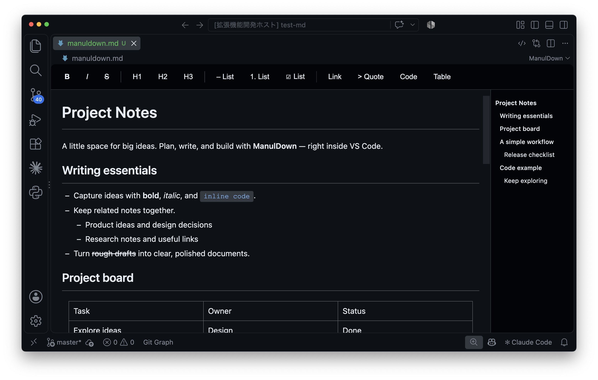

[English](./README.md) / [日本語](./README.ja.md)

# ManulDown for VSCode

ManulDown is a VSCode extension for editing Markdown while viewing the rendered result. Changes are reflected in the Markdown file.



## Features

- WYSIWYG editing for headings, formatting, lists, task lists, and tables
- Image paste and drag-and-drop, with images following document moves
- URL and workspace file links, footnotes, and an automatic table of contents
- Syntax-highlighted code blocks, TeX formulas, and Mermaid diagrams
- PDF preview, page break and layout adjustments, and export
- Automatic Markdown syntax conversion, search, and Undo/Redo
- VSCode theme support, including high contrast themes

## Usage

1. Open a Markdown file (`.md`).
2. Run **ManulDown: Open with ManulDown Editor** from the command palette.

You can also right-click a file in the Explorer and choose **Open With… → ManulDown**.

Switch between ManulDown and the Markdown source with the code/pencil buttons in the editor title or `Cmd+Option+M` / `Ctrl+Alt+M`. The corresponding caret position and selection are preserved, and the restored caret is brought into view.

### Basic Editing

Use the toolbar to format text and insert elements. Buttons that do not fit are available in the **…** menu.

Open **… → Settings** and search for `manulDown.toolbar.items` (**Toolbar: Items**) to choose the buttons with checkboxes. Changes apply immediately to open editors. H1–H6 can be selected individually. Link, Image, Footnote, Inline Math, Math Block, and H4–H6 are hidden by default. Unchecked tools are also hidden from **…**; slash commands and shortcuts remain available. HTML, PDF, and Word export and Settings always stay in **…**.

| Button | Action |
| --- | --- |
| **B** / **I** / **&lt;/&gt;** | Toggle bold, italic, or inline code |
| **H1–H6** | Change heading level (H1–H3 enabled by default) |
| **• / 1. / ☑** | Switch to an unordered, ordered, or task list |
| **Link** | Insert or edit a link |
| **Footnote** | Add a footnote |
| **Code** | Insert a code block |
| **Math** / **Math Block** | Insert an inline formula or math block |
| **Image** | Import and insert an image file |

Markdown patterns such as `# Heading`, `**bold**`, `*italic*`, `- item`, and `1. item` convert as you type. To create a code block, type a language fence such as `` ```javascript `` and press `Enter`.

### Links

Select text and use **Link**, `/link`, or `Cmd+K` / `Ctrl+K` to open the link field. Enter a URL (HTTP, HTTPS, or `mailto:`), an absolute workspace path, or a relative path starting with `./` or `../`, then press **Apply** or `Enter`. Type at least two characters to search for workspace files.

Workspace files are saved as relative links. Pasting an absolute file path over selected text also creates a link. Invalid and out-of-workspace paths remain plain text.

Open links with `Cmd+Click` / `Ctrl+Click`, or place the caret inside a link and press `Cmd+Enter` / `Ctrl+Enter`.

### Footnotes

Use **Footnote** or `/footnote` to add a note, then edit its text at the end of the document. ManulDown supports `[^label]` and `[^label]: note`, displaying notes in reference order.

- **Navigate**: Click a reference number to open its note, or ↩ to return to the text. With the keyboard, select a number using `Tab` or `Left` / `Right`, then press `Enter` to jump.
- **Delete a whole note**: Select its number in the note list and press `Backspace` (or `Ctrl+H` on macOS). This also removes all its references.
- **Delete one reference**: Use `Backspace` / `Delete` on a body reference. Deleting the last reference also deletes its note.

Copying or moving text preserves its corresponding notes.

### Images and Document Moves

Import images by pasting, dragging and dropping, or using **Image**. They are saved beside the Markdown file in `images/<document name without extension>/`.

When you move or rename a `.md` file inside VSCode, used images in that folder follow it and links are updated. For example, moving `docs/memo.md` to `archive/notes.md` moves images from `docs/images/memo/` to `archive/images/notes/`.

- Images shared with other Markdown documents are copied; unused images stay in place.
- Incoming files receive numbered names to avoid collisions, and empty image folders are removed. Document and image moves share one Undo/Redo step.
- Set `manulDown.images.moveWithDocument` to `false` to disable automatic image moves.

Both locations must be in trusted workspace folders, and `markdown.updateLinksOnFileMove.enabled` must be `never`. With `always` or `prompt`, VSCode handles link updates and images stay in place. Moves outside VSCode are not tracked.

To resize an image, select it with `Left` / `Right` from its edge, then use `Shift+Up` / `Shift+Down` to enlarge or shrink it. Importing images from local file URLs inside HTML and using symbolic links as image save folders are not supported.

### Copying

- **Copy as Markdown**: Right-click a selection to copy it as Markdown, including formatting, links, images, and footnotes. You can also use `Cmd+Shift+C` / `Ctrl+Shift+C`.
- **Normal copy**: A single image copies as PNG; text with images or multiple images copies as HTML with embedded images. The destination must support HTML paste; multiple images are not sent as separate attachments. Animations copy as still images.

If an image cannot be copied, ManulDown shows a warning and copies text and image references instead.

### Math

TeX formulas are rendered with [KaTeX](https://katex.org/supported.html).

- **Inline formulas**: Type `$E = mc^2$` without spaces just inside the `$` delimiters. Click a formula, or select it and press `Enter`, to edit. Press `Enter` to apply or `Esc` to cancel.
- **Math blocks**: Type `$$` on an empty line and press `Enter`, or use `/math` or **Math Block**. The **Preview** switch toggles between TeX editing and the rendered formula.

```` ```math ```` code blocks are also supported. Unchanged formulas keep their original syntax.

### Mermaid Diagrams

Create a code block with its language set to `mermaid`, then use **Preview** to switch between source and diagram. The copy icon copies the source; the download icon saves PNG or SVG.

The expand icon opens the diagram across the editor. Scroll to zoom, drag or use arrow keys to pan, choose **Fit** to see the whole diagram, and press `Esc` to close.

### Exporting HTML

Choose **… → Export as HTML…** to save a standalone `.html` file. Styles, images, syntax highlighting, math fonts, and Mermaid rendering are embedded, so the file can be opened offline in a browser without installing Chrome or Edge for export. Formulas and diagrams render when opened with JavaScript enabled. The layout adapts to the browser width.

Remote images follow `manulDown.security.allowRemoteImages`; unavailable or blocked images show alternative text. As with PDF output, external web links and document anchors are preserved; workspace file links are omitted.

### Exporting Word documents

Choose **… → Export as Word…** to save the current edits as a `.docx` file. Headings, tables, lists, footnotes, and supported equations are editable in Word. Images are embedded and remote images follow the same setting as HTML and PDF export. Mermaid diagrams are saved as code blocks.

### Exporting PDF

Click a thumbnail in the left sidebar to jump to that page. The page at the top edge of the preview is current, and its thumbnail is outlined as you scroll. If the top edge is in a gap, the following page is current. Use the sidebar icon to show or hide thumbnails, or focus a thumbnail and use ↑ / ↓ or Home / End to navigate. The footer also provides previous/next buttons and a page number field; press Enter to jump.

The preview uses English labels, like the editor and Mermaid viewer, and shares its toolbar, footer, controls, and zoom styling with Mermaid. Use **+ / −, 100%, Fit** in the footer, click the zoom percentage to choose a preset, or use **+ / −, 0, F** on the keyboard. Choose **Done** to leave page break editing.

Open **… → Export as PDF…** in the toolbar to preview your document as pages. Turn on **Page breaks** to see faint horizontal lines between paragraphs, headings, images, tables, lists, or code blocks. Hover or focus a line to highlight it, then click to insert a break. Blocks that already start a page have no insertion line. Manual breaks appear in the page gap with a centered **Remove page break** action. Use the confirmation's **Undo** to quickly reverse a change, or **Clear all** to remove all manual breaks. Choose **Done** to hide all editing controls. **Layout** controls paper size, orientation, margins, text size, and page numbers.

Choose **Export…** to save the PDF shown in the preview. Images, formulas, and Mermaid diagrams are included, and long tables repeat their headers on subsequent pages. Missing images or diagram errors appear as notices in the preview.

Page breaks are saved automatically in VS Code's private storage for each document and restored when you reopen it in the same VS Code environment. Markdown and its regular editing menus stay unchanged. Use **Undo / Redo** in edit mode, Ctrl/Cmd+Z, or Ctrl+Y / Cmd+Shift+Z. After editing Markdown, choose **Refresh**: breaks follow their source content and neighboring blocks where possible. If a target is deleted or cannot be identified, its break is removed with a notice. Breaks inside a paragraph or line are not supported.

PDF export supports local workspaces in VS Code Desktop and requires Google Chrome or Microsoft Edge. Browsers in standard locations are detected automatically. If needed, set `manulDown.pdf.browserPath` to the browser executable. On macOS, an `.app` path is also accepted.

### Preserving Markdown Source

Opening a file leaves its source unchanged. When editing, unchanged blocks, inline formatting, table spacing, and blank lines retain their original syntax.

Front matter, raw HTML, and reference definitions also keep their source. GitHub alert markers such as `[!NOTE]` are displayed as read-only source.

### Slash Commands

Type `/` at the start of a line or after whitespace to open the insert menu. Directly after text, use `Control+/` on macOS or `Alt+/` on Windows/Linux. Type to filter, select with arrows or `Tab`, press `Enter` to run, or `Esc` to cancel.

| Command | Action |
| --- | --- |
| `/link` | Insert a link |
| `/toc` | Insert a table of contents block that updates with headings |
| `/footnote` | Add and edit a footnote |
| `/table` | Insert a 2×2 table |
| `/quote` | Convert to or insert a blockquote |
| `/callout` | Insert a callout using the configured default service |
| `/code` | Insert a code block |
| `/math` | Insert a math block |
| `/inline-math` | Insert an inline formula |
| `/checkbox` | Create a task list |
| `/settings` | Open ManulDown settings |

A `/toc` block updates as headings are added, edited, moved, or removed. Click an item or navigate with arrows and `Tab`, then press `Enter` to jump to its heading. Its contents are read-only. Click the frame's padding to select the whole block, then press `Backspace` / `Delete` to delete it at once.

To make an existing plain-list table of contents update automatically, replace it with a new `/toc` block.

The slash menu is unavailable inside code blocks, table cells, or during IME composition.

Add a file such as `~/.manuldown/meeting-minutes.md` to insert its contents with `/meeting-minutes`. Custom commands appear in green. Names are lowercased and spaces become `-`; names that duplicate built-in commands or another file are ignored.

### Keyboard Shortcuts

| Action | macOS | Windows / Linux |
| --- | --- | --- |
| Bold | `Cmd+B` | `Ctrl+B` |
| Italic | `Cmd+I` | `Ctrl+I` |
| Strikethrough | `Cmd+Shift+X` | `Alt+Shift+5` |
| Insert link | `Cmd+K` | `Ctrl+K` |
| Insert menu | `Control+/` | `Alt+/` |
| Open link | `Cmd+Enter` | `Ctrl+Enter` |
| Copy as Markdown | `Cmd+Shift+C` | `Ctrl+Shift+C` |
| Undo / Redo | `Cmd+Z` / `Cmd+Shift+Z` | `Ctrl+Z` / `Ctrl+Shift+Z` |
| Find | `Cmd+F` | `Ctrl+F` |
| Next / previous match | `Enter` / `Shift+Enter` | `Enter` / `Shift+Enter` |
| Toggle editor | `Cmd+Option+M` | `Ctrl+Alt+M` |

#### Table Operations

Select a range of cells, a row, or a column to apply or remove toolbar formatting across the selection.

| Action | macOS | Windows / Linux |
| --- | --- | --- |
| Insert row / column | `Cmd+Ctrl+Shift+Up/Down/Left/Right` | `Ctrl+Shift+Alt+Up/Down/Left/Right` |
| Select column | `Ctrl+Shift+Option+Up/Down` | `Ctrl+Alt+Up/Down` |
| Select row | `Ctrl+Shift+Option+Left/Right` | `Ctrl+Alt+Left/Right` |
| Move selected column / row | `Shift+Left/Right` (column), `Shift+Up/Down` (row) | `Shift+Left/Right` (column), `Shift+Up/Down` (row) |

#### Emacs Keybindings (macOS Only)

| Action | Key |
| --- | --- |
| Move up / down | `Ctrl+P` / `Ctrl+N` |
| Move left / right | `Ctrl+B` / `Ctrl+F` |
| Move to line start / end | `Ctrl+A` / `Ctrl+E` |
| Delete line / list item | `Ctrl+K` |
| Yank last `Ctrl+K` text | `Ctrl+Y` |
| Delete backward one character | `Ctrl+H` |

### Settings

Use **… → Settings** in the toolbar or `/settings` to open ManulDown settings.

| Setting | Default | Description |
| --- | --- | --- |
| `manulDown.toolbar.visible` | `true` | Show the toolbar |
| `manulDown.toolbar.items` | Per-button defaults | Select toolbar buttons with checkboxes; H1–H6 are available |
| `manulDown.toc.enabled` | `true` | Automatically show a table of contents when headings exist |
| `manulDown.callout.defaultService` | `github` | Format for `/callout`: GitHub / GitLab, Qiita, Zenn, Obsidian, Docusaurus / VitePress, or MkDocs. Changes apply to new callouts immediately |
| `manulDown.openByDefault` | `true` | Open Markdown with ManulDown by default |
| `manulDown.list.dashStyle` | `false` | Use `-` for bullet markers |
| `manulDown.list.indentSize` | `2` | Indentation width when the document style cannot be detected (`2` or `4` spaces) |
| `manulDown.images.moveWithDocument` | `true` | Move images with document moves and renames |
| `manulDown.pdf.browserPath` | Empty | Chrome, Edge, or Chromium executable for PDF export; empty detects an installed browser (user settings only) |
| `manulDown.security.allowRemoteImages` | `false` | Display remote HTTP/HTTPS images |
| `manulDown.security.allowRemoteImageImport` | `false` | Download and import remote HTTP/HTTPS images |
| `manulDown.security.allowFileLinks` | `false` | Open `file://` and local links outside the workspace |

The `manulDown.security.*` options can only be changed in user settings. Enabling them allows outbound requests, image downloads, or opening local files, applications, and network shares. Enable them only for Markdown you trust.

Creating a link does not access its URL. Opening local links outside the workspace requires `manulDown.security.allowFileLinks`.

## Development

Use Node.js 22.13 or later for development. PDF.js ships as browser assets and is not loaded as a Node.js library by the extension host.

```sh
npm ci
npm run compile
npm test
npm run lint
```

Run `npm run test:pdf` with Chrome or Edge installed to verify actual PDF generation and the preview UI.

Use `npm run watch` to watch TypeScript changes. Extension code is in `src/`, editor UI in `media/`, and tests in `test/`. See [CHANGELOG.md](./CHANGELOG.md) for release history.

## License

[MIT](./LICENSE)

UI icons use IBM [Carbon Icons](https://github.com/carbon-design-system/carbon/tree/main/packages/icons) under Apache 2.0. See [third-party notices](./THIRD_PARTY_NOTICES.md).
