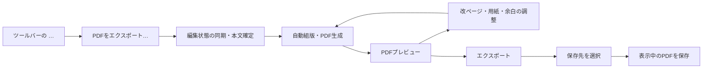

# PDF出力の実装計画

作成日: 2026-11-16。通常のMarkdown編集をシンプルに保ち、PDFプレビュー内で出力を調整する初版を実装済み。以下に設計方針と、末尾に実装・検証結果を記録する。

**推奨方針**

操作の流れは「ツールバーの **… → PDFをエクスポート… → PDFプレビュー → 必要なら改ページ・レイアウトを調整 → エクスポート → 保存先を選択**」とする。プレビューを最初の実用版の中心に置く。

既存のMarkdown解析を共有し、PDF用の読み取り専用HTMLをChromium系ブラウザーで組版する。印刷用CSSによる自動改ページを基本にし、手動の改ページ位置はPDFプレビューの状態として持つ。Markdownへの改ページ記法の追加、通常の挿入メニューへの改ページ項目の追加は行わない。

最初の実用版は、VS Code Desktopのローカル環境で、編集中の文書を検索・コピー可能なPDFとして確認・調整・保存できるところまでとする。初期値はA4・縦・白背景とし、エディタのダークテーマやウィンドウ幅によってページ構成が変わらないようにする。

**1. 現在の構成と、設計への影響**

| 確認した実装 | PDF出力で必要になること |
| --- | --- |
| [`MarkdownDocument.toHtml()`](../src/editor/MarkdownDocument.ts) がMarkedと独自処理で、目次・脚注・Callout・数式などを解析する | 既存の解析を共有する。PDF専用の別パーサーを導入すると、編集時との記法の差が生じる |
| [`MarkdownEditorProvider`](../src/editor/MarkdownEditorProvider.ts) と [`editor.js`](../media/editor.js) がリビジョン付きの同期スナップショットを交換する。通常の更新には遅延がある | ディスク上のファイルを読むだけでは、出力直前の編集が抜ける。既存の同期処理を経て確定した本文を取得する |
| [`MathManager`](../media/modules/MathManager.js) は数式をShadow DOMに描画する | `innerHTML`や通常のDOMクローンでは数式の表示結果を取り出せない。元のTeXからPDF用DOMに再描画する |
| [`CodeBlockManager`](../media/modules/CodeBlockManager.js) がMermaidを遅延ロード・非同期描画し、コードと図を切り替える | 出力専用の描画完了処理が必要。PDFでは表示切り替え状態にかかわらず、Mermaidは図、数式は組版結果を出す |
| [`editor.css`](../media/editor.css) はVS Codeのテーマ変数・スクロール領域・編集用UIを前提にする | 本文の基本スタイルを共有しつつ、紙面用CSSを分ける。ツールバー、検索表示、選択表示などはPDFに含めない |
| [`ToolbarManager`](../media/modules/ToolbarManager.js) は`data-overflow-only`の項目を「…」内に固定する仕組みを持つ | PDFの入口に利用する。文書全体への操作として扱い、選択中の要素やカーソル位置に依存させない |
| ローカル画像はホスト側でパスと容量を検証し、バイト列から表示する。生HTMLは実行可能なHTMLとして描画しない | 同じ制約をPDFでも維持する。Webview専用URLや任意の`file://`参照に依存しない |
| [`package.json`](../package.json) はVS Code `^1.85.0`、[`bundle-host.js`](../scripts/bundle-host.js) はNode 18を対象にする。VSIXは`node_modules`を含めない | PDFライブラリの実行環境とバンドル方法を先に確認する。開発環境だけで動く構成にしない |

**2. PDF生成エンジンと配布方法**

初版は、別プロセスのChromium系ブラウザーにDevTools Protocolで接続し、印刷APIを呼び出す方式を採用した。必要な通信だけをホスト側の小さなパイプ接続にまとめ、VS Code内部のElectronや、公開されたデバッグポートに依存させない。既存のHTML・CSS、MermaidのSVG、KaTeXの描画を利用する。[実装](../src/export/BrowserPdfRenderer.ts)

ブラウザー本体は初版では既存のChrome / Edgeを検出し、必要なら利用者が実行ファイルを指定する案を推奨する。ブラウザーが見つからない場合は、必要な設定を案内する。専用ブラウザーの取得・更新・キャッシュ管理は後続で検討する。`puppeteer-core`自身はブラウザーをダウンロードしないため、導入しただけで利用者環境のブラウザーが用意されるわけではない。[Installation](https://pptr.dev/guides/installation)

比較候補だった最新PuppeteerはNode 22.12以上を要求し、現行の最低動作環境とは合わない。初版ではホストにPuppeteerを追加せず、VS Codeの最低対応版とNode 18向けのビルドを維持した。PDF.jsはブラウザー用アセットとして同梱し、拡張機能ホストには読み込まない。開発環境にはPDF.jsの開発依存に合わせてNode 22.13以上を使用する。[System requirements](https://pptr.dev/guides/system-requirements)

検証では、ブラウザーのバージョン差、Node互換性、起動時間、VSIXのサイズと依存ファイル、ライセンス表示も確認する。ブラウザーの実行パス設定はユーザー設定に限定し、ワークスペースから任意の実行ファイルを指定できないようにする。

VS Codeの公開Webview APIにはPDF保存用のメソッドがないため、エディタ内の`window.print()`やVS Code内部のElectron APIに依存する設計は採用しない。[VS Code API](https://code.visualstudio.com/api/references/vscode-api#Webview)

プレビューには独立したWebviewパネルを用意し、生成したPDFを、同梱したPDF.jsなどの表示ライブラリでページ単位に描画する。画面表示と保存に同じPDFバイト列を使い、改ページの一致を保証する。PDF.jsの表示層はブラウザー上でPDFページを描画できる。採用時はWebviewとの互換性、ワーカー、フォントなどの追加アセット、CSP、ライセンス、バンドル容量を段階0で確認する。[PDF.js Examples](https://mozilla.github.io/pdf.js/examples/)、[Getting Started](https://mozilla.github.io/pdf.js/getting_started/)

Remote SSH / WSL / Dev Containers / Codespacesでは、拡張機能ホストと画面側で実行場所が異なることがある。初版ではPDF出力の対応範囲を通常のローカル環境に限定し、未対応環境では理由を表示する。後続対応時は、ブラウザーを動かす場所とファイルの読み書きを合わせて設計する。[Remote Development](https://code.visualstudio.com/api/advanced-topics/remote-extensions)

**3. 出力処理の流れ**

1. 「…」内に`data-overflow-only`の「PDFをエクスポート…」ボタンを置く。画面幅が広くても通常のツールバーへ移動させない。書式操作とは分けたハンドラーからプレビューを開き、目次や図を選択している場合も実行できるようにする。プレビューを開いた直後にエディタへフォーカスを戻さない。
2. PDFプレビューパネルを開いて準備中の表示を出す。ブラウザーやPDF表示用アセットはこの時点で読み込み、通常のMarkdown編集の起動を重くしない。同じ文書のプレビューが開いていれば既存パネルを表示する。
3. 保存・タブ終了で使う同期キューを共有する形で`captureExportSnapshot()`を用意する。IME確定処理、リンク入力欄などの一時編集、貼り付け画像の取り込みを完了させる。変換エラー、外部変更との未解決の競合、タイムアウトがある場合はプレビューに理由を示す。
4. 同期が終わった時点の本文、文書URI、文書バージョンを固定し、出力セッションを作る。Markdownのディスク保存は要求しない。後続の編集内容を生成中のPDFに混ぜない。
5. 固定した本文を共有パーサーでHTML化し、編集用ラッパーやキャレット用プレースホルダーを除いた出力DOMを作る。生の編集DOMは出力の入力にしない。改ページ対象となる見出し・段落・表・図などに出力セッション内だけで有効なIDを付ける。
6. ローカル画像を既存の境界・容量検証を通して読み込み、出力用に解決する。画像、CSS、フォントの参照先をWebview専用URLから独立させる。同じセッション内では取得した画像を再利用し、レイアウト調整のたびに内容が入れ替わるのを防ぐ。
7. 拡張機能に同梱したPrism・KaTeX・Mermaidを使い、出力用の明るい配色で描画する。KaTeXはPDF用DOMに組版し、MermaidはSVGで保持する。
8. 図の描画Promise、画像の読み込み、`document.fonts.ready`を明示的に待つ。固定秒数の待機だけでは完了とみなさない。印刷レイアウト確定後に、巨大要素や横方向のはみ出しを検査してPDFを生成する。
9. 生成したPDFをページ単位でプレビューする。初期表示ではプレビューと「エクスポート」を中心に置き、「改ページを調整」「レイアウト」は必要なときだけ開く。
10. 改ページ・用紙・余白などを変更したら、同じ本文スナップショットからPDFを再生成する。生成中は「更新中」と表示し、エクスポートを無効にする。要求ごとに世代番号を持ち、古い生成結果が新しい表示を上書きしないようにする。
11. 「エクスポート」を押した時点で完成・表示済みのPDFを確定し、保存先を選択してそのバイト列を保存する。保存のためだけに再生成したり、最新の本文を黙って取り直したりしない。
12. プレビューを閉じた場合や失敗・キャンセル時には、表示タスク、ワーカー、ブラウザー、一時ファイルを片付ける。生成中の終了や保存失敗で既存の出力ファイルを壊さない。

PDF用の処理は`src/export/`にまとめ、既に大きい`MarkdownEditorProvider.ts`への追加は同期・コマンドの接続部分を中心にする。候補となる分割は以下のとおり。

| ファイル・モジュール案 | 役割 |
| --- | --- |
| `PdfExportService.ts` | 出力の進行、キャンセル、保存、失敗時の片付け |
| `ExportSnapshot.ts` | 固定した本文・文書URI・設定の型と取得境界 |
| `PdfExportSession.ts` | 本文スナップショット、出力設定、改ページ位置、調整のUndo/Redo、生成世代、完成済みPDFの管理 |
| `PdfPreviewProvider.ts` | プレビューパネル、表示・調整・保存のメッセージ処理と文書更新の検知 |
| `PdfHtmlBuilder.ts` | 共有Markdown解析の結果から読み取り専用HTMLを生成 |
| `ExportResourceResolver.ts` | ホスト側の既存画像処理から共通化する検証と、PDF用アセットの解決 |
| `BrowserPdfRenderer.ts` | ブラウザー起動、描画完了待ち、PDFバイト列の取得 |
| `media/export.css` / `media/export.js` | 印刷レイアウトと図・数式の描画。必要な共通処理だけ既存モジュールから抽出 |
| `media/pdf-preview.js` / `media/pdf-preview.css` | PDFのページ表示、用紙設定、改ページ対象の選択、状態表示 |

**4. 自動改ページの初期仕様**

優先順位は「本文を欠落させない → 手動指定 → 見出しと本文のまとまり → 短いブロックを保つ → 余白を減らす」とする。

| 要素・状況 | 初期仕様 |
| --- | --- |
| 見出し | 見出しだけをページ末尾に残さず、続く本文と一緒に送る。見出しが連続する場合も考慮する |
| 段落 | 長い段落は行単位で分割し、ページの上下に1行だけ残る状態を避ける。`widows` / `orphans`は3行を初期値にする |
| 箇条書き・番号付きリスト | 短い項目はできるだけ同じページに保ち、長い項目やリスト全体は分割を許可する。継続ページで番号・入れ子・チェック状態が崩れないようにする |
| 表 | ページをまたぐ表は行の境界で分割し、ヘッダー行を繰り返す。表全体の分割禁止は設定しない |
| 1ページより高い表の行 | 内容の分割を試す。ブラウザーで欠落なく扱えないケースは検知して出力を止め、該当する表の修正を案内する |
| 横に広い表 | セル内の折り返しを優先する。収まらない場合は横向き出力などを案内し、読めない大きさまで自動縮小しない |
| コードブロック | 短いブロックはまとめ、長いものは行単位で分割する。横にはみ出すコードは表示上折り返し、空白とインデントを維持する |
| 画像・Mermaid・独立した数式 | 原則として途中で分割せず、縦横比を保って本文領域内に収める。著しく小さくなる場合は利用者に知らせる |
| 引用・Callout | 短いものはまとめ、長いものは段落境界で分割する。Calloutのタイトルだけをページ末尾に残さない |
| 水平線 | 区切り線として出力する。手動改ページとは別の意味として扱う |

CSSの`break-before` / `break-after` / `break-inside`を基本にする。ただし`avoid`は絶対的な保証ではなく、ページより大きい内容では制約が緩められる。全ブロックに一律で分割禁止を指定せず、必要な箇所だけ、印刷幅での実測に基づいて補正する。独自の全文ページ分割エンジンは、CSSで解決できない具体例が確認された場合に検討する。[CSS Fragmentation](https://www.w3.org/TR/css-break-3/)

**5. PDFプレビュー内での調整**

初版は「ここから次のページ」「指定した改ページの解除」「改ページを自動に戻す」を基本操作にする。初期状態では自動組版したPDFを表示し、修正が必要な場合にだけ「改ページを調整」を開く。本文の書き換えは通常のエディタで行い、PDF画面では出力の配置を調整する。

対象はトップレベルの見出し・段落・リスト・表・コード・図などの直前とする。実装上は、選択された出力用IDに対してPDF用DOMだけに`break-before: page`を付ける。表の行や長い段落の途中など、内部の任意位置の手動分割は初版の範囲に含めない。

PDFの表示ライブラリだけではMarkdownのブロック境界は分からず、ブラウザーの通常画面で測った座標も印刷後のページ位置とは一致しない。初版はプレビュー内の補助パネルで、見出しや本文の短い抜粋から対象を選ぶ方式を基本にする。見出しを中心に表示し、必要に応じて段落・表・図などを選べるようにする。PDF上の境界を直接クリックするハンドルは、正確な対応付けを技術検証できた場合に追加する。

改ページ指定は固定した本文スナップショット内のIDに関連付け、PDFプレビューのセッションに保持する。Markdown本文、フロントマター、専用コメントには書き込まない。調整の取り消し・やり直しはプレビュー専用に管理し、Markdown編集のUndo/Redoに混ぜない。文頭・文末・同じ箇所への重複指定が空白ページを生まないようにする。

初版では改ページ指定はプレビューを閉じるまで有効とする。次回以降の再利用が必要になった場合は、文書外の保存先と本文変更時の関連付けを別途設計する。用紙・余白などの一般設定はユーザー単位で記憶してよいが、改ページ位置と区別する。

プレビュー中に元の本文が更新された場合は「本文が更新されました」と表示し、最新の本文で更新するまでエクスポートを無効にする。「最新の本文で更新」を押したらスナップショットを取得し直し、用紙設定を保ったまま改ページの個別指定を初期化する。この動作は更新ボタン付近で示し、古い位置指定を別の段落へ適用しない。

改ページ指定や選択の表示はプレビュー用UIとして持ち、保存用PDFには操作ボタンやガイドを含めない。PDF上にガイドを重ねる場合も表示用のレイヤーに限定する。長い文書では表示中とその周辺のページを優先して描画し、プレビューの倍率を変えても紙面の組版自体は変えない。

**6. 用紙・文字・リンクなどの仕様**

| 項目 | 初期仕様・考慮点 |
| --- | --- |
| 用紙 | A4縦を標準に、プレビューの「レイアウト」でLetter・横向きも選択可能にする |
| 余白・文字サイズ | 本文余白18mm、本文10.5pt、行間1.6を初期案とし、実物で調整する。プレビューでは「標準」「狭い」などの少数の選択肢を基本にし、用紙・余白の設定元を一箇所に集約する |
| 配色 | 白背景と印刷用の明るい配色。コードやCalloutは淡い背景と十分なコントラストを確保する |
| 日本語・フォント | 禁則処理、長いURL、英日混在、全角記号、絵文字、太字を確認する。OS間の組版再現性を重視する場合は、日本語フォントの同梱・埋め込みとライセンス・容量を技術検証で判断する |
| ページ番号 | フッターに現在ページ / 総ページを表示できるようにする。本文と重ならない領域を確保し、ローカルファイルの絶対パスなどを自動挿入しない |
| 本文内目次 | 本文中に挿入された目次は出力し、サイドバーの目次は出力しない。日本語・重複見出しの既存ID生成を共有する |
| リンク | HTTPSリンク、見出しへの内部リンク、脚注リンクを実際のPDFで検証する。相対ファイルリンクは配布先で成立しない場合があるため、初版は表示テキストを保持し、ローカル絶対パスへ書き換えない |
| 脚注 | 初版はPDF用DOMで文末注に集約し、本文の参照番号・リンク・戻り先を維持する。元Markdownの定義位置は変更しない。各ページ下部への脚注配置は後続対応とする |
| 生HTML・未対応記法 | 現在のエディタと同じくソースとして扱う。フロントマターからの出力設定や任意CSSの読み込みは別機能として検討する |
| 検索・コピー | 本文を画像化せずテキストとして出力する。数式・SVGの読み上げ順や完全なアクセシビリティ適合は別途検証する |

図・数式の構文エラーや画像の欠損は、黙って取り除かない。原文・代替表示を残してプレビュー内に問題を示し、書き出す前に原因を確認できるようにする。本文の切り落としが見込まれるなど、内容を保持できない場合はエクスポートを無効にする。

リモート画像には既存の`manulDown.security.allowRemoteImages`と同じ表示ポリシーを適用する。ホストで許可済みの画像と同梱アセットを準備し、生成ブラウザーから任意のネットワーク・ローカルファイルを読ませない。SVGやMermaid内の外部参照も対象にする。KaTeXの`trust: false`、Mermaidの`securityLevel: strict`も維持する。

**7. 実装の順序と、各段階の完了条件**

| 段階 | 実装・検証すること | 完了条件 |
| --- | --- | --- |
| 0. 技術検証 | ブラウザー制御とPDF表示のライブラリ・配布方法を決める。日本語、KaTeX、Mermaid、画像、長い表を含むPDFをWebviewに表示する。Node・VS Code互換性、OSごとの起動、ワーカー・CSP、VSIX内の実行を確認する | 最低対応環境、ブラウザー、依存ファイルと容量を説明でき、生成したPDFを欠落なく表示・保存できる。改ページ対象の選択方式が成立する |
| 1. プレビューから保存まで | 「…」内の入口、スナップショット、PDF用HTML/CSS、画像解決、図・数式描画、ページ表示、保存、進行表示・キャンセルを実装する | 未保存の最新編集を含むPDFをプレビューでき、確認したPDFをそのまま保存できる。通常の挿入メニューに項目が増えない |
| 2. 自動改ページ | 見出し・段落・表・リスト・コード・図の分割ルールと、巨大要素の検査を実装する | 境界用のサンプルで見出しの孤立や本文の欠落がなく、長い表・コードが複数ページにわたり読める |
| 3. プレビュー内の調整と公開準備 | 改ページの追加・解除・リセット、調整のUndo/Redo、用紙・余白・ページ番号、再生成制御、本文変更時の更新、READMEの日英更新、パッケージ確認を行う | プレビュー内で調整して保存でき、Markdownの内容や編集履歴に出力用の指定を混ぜない。古いプレビューを誤って保存せず、対象OSのVSIXで利用できる |
| 4. 後続の改善 | PDF上での改ページ位置の直接操作、改ページ指定の再利用、管理されたブラウザー取得、見出し単位の改ページ設定、PDFのしおり、ページ番号付き目次、Remote対応を検討する | 実際の利用で優先度を決める。通常のMarkdown編集画面をシンプルに保つ方針を維持する |

最初の実用版は、プレビューとその場での改ページ調整を含む段階0〜3とする。各ページ下部の脚注、PDF/A・PDF/UAへの適合、任意テンプレートなどは追加要件として扱う。

**8. 検証計画**

既存の`node --test`にはDOMや変換を検証するテストがあるが、実際の印刷レイアウトはブラウザーで生成したPDFで確認する必要がある。

- 入口・画面の確認: 「…」内への固定、ウィンドウ幅によらない到達性、キーボード操作、読み取り専用の要素を選択した状態からの起動、プレビューへのフォーカスを検証する。挿入メニューに改ページが追加されていないことも確認する。
- 変換テスト: 独自記法の描画、出力用UIの除去、出力セッション内のブロックID、脚注・目次のID、画像の許可境界を検証する。改ページ調整によってMarkdown本文や編集履歴が変わらないことを確認する。
- 同期テスト: 入力直後、IME変換直後、画像貼り付け直後、リンク編集途中、外部変更競合、変換失敗を対象にする。出力中の追加入力が固定した本文を変えないことも確認する。
- PDF結合テスト: 実ブラウザーで生成し、PDFから抽出したページ別テキストとリンク先を確認する。図・数式・画像はページ画像でも確認する。プレビューのPDFと保存されたPDFのバイト列が同じことも検証する。
- 改ページの境界テスト: ページ末尾付近の見出し、長い段落、入れ子リスト、複数ページの表とコード、非常に高い表の行、巨大な図、文頭・末尾・重複した手動指定を用意する。追加・解除・リセット・Undo/Redo後のページ構成も確認する。
- プレビューの状態テスト: 設定を連続変更したときの古い生成結果、生成中のエクスポート、元本文の変更と再読み込み、プレビューの再表示と終了を検証する。倍率変更で紙面の構成が変わらないこと、大量ページの遅延描画も確認する。
- 外観の回帰確認: 日本語と英語を混在させた代表文書を、固定したブラウザーとフォントでレンダリングする。OS依存の画像差分と、欠落・はみ出し・ページ境界の問題を区別する。
- 配布確認: `npm test`、`npm run lint`、VSIXの作成とインストール後の出力を確認する。ブラウザー未検出、オフライン、保存キャンセル、描画タイムアウト、大きい文書での中断とプロセスの片付けも対象にする。

着手時はまず段階0で、実行環境と日本語・数式・図を含むPDFの生成・表示が成立することを確認する。その結果を確定してから、「…」からの起動、プレビュー内の調整、確認したPDFの保存を順に実装する。

**9. 初版の実装・検証結果**

初回表示の改善では、VS Code Webviewの制約で失敗していたPDF.jsのワーカー読み込みを、完全なバンドルを取得してBlobワーカーへ渡す方式に修正した。パーサーと描画ワーカーをプレビュー内で再利用し、フォントなどの追加アセットはWebview側で取得する。最初の可視ページを隣接ページより先に描画する。同じ6ページの文書で、PDFプレビューのスクリプト開始から最初のページ表示まで約1.3秒を実機で確認した。

- 「…」内の固定ボタンから、実際のPDFを表示するプレビューを開く経路を追加した。プレビュー内の用紙・縦横・余白・文字サイズ・ページ番号、改ページの追加・解除・リセット・Undo/Redoに対応した。
- 本文スナップショットと改ページ位置を別に管理し、Markdown本文と編集履歴への出力指定の書き込みを避けた。本文更新、再生成中、表示未完了のPDFの保存を防ぎ、表示確認したPDFバイト列をそのまま一時ファイル経由で保存する。
- 日本語、ローカル画像、数式、Mermaid、長いコード、表ヘッダーの繰り返し、ページ末尾の見出し、手動改ページ、横向き、キャンセルをmacOSのChromeで検証した。生成したPDFのページ画像とプレビュー画面も確認した。
- 通常のテスト、実ブラウザーテスト、lint、VSIXの作成と一時ディレクトリへのインストールを確認した。VSIXは約5.4MBで、ホスト用バンドルとPDF.jsの表示用ファイル・ワーカー・フォントなどを同梱する。
- Windows / Linux上での実機確認、Remote環境は後続の確認・改善対象とする。

### ページ上での改ページ編集と永続化

「改ページを調整」を編集モードのON/OFFボタンに変更した。通常表示ではガイドを持たず、編集時だけブロック間のホバー位置に追加ボタンを出す。手動改ページは破線と削除ボタンで常時区別し、再生成後は操作したブロックの画面内位置を保持する。ズームやレイアウトの変更、Undo/Redoにも対応する。

ソース対応は既存の `MarkdownDocument.getSourceBlocks()` と全文のHTMLを照合して作る。ブロックの原文から作る識別情報、前後のブロック、直前の見出しを文書URI単位でVS CodeのglobalStateへ保存する。Markdownには専用コメントを追加しない。再起動・本文更新時には内容の一致と周辺文脈から復元し、一意に対応できない削除・変更は解除して知らせる。PDF座標やズーム率は永続データに含めない。

描画座標はChromiumが実際に印刷したPDFから求める。各ブロック先頭に文字を持たない一時的なリンクを配置し、そのPDF注釈の矩形とページ番号を読み取ったあと、リンク注釈をPDFから除去する。WebviewのDOM高さから印刷結果を推測しないため、表やコードがページをまたぐ場合、見出しのkeep-with-nextや段落のwidow/orphan制御が働く場合も印刷後の座標に対応できる。追加の印刷は行わず、除去後の同一バイト列をプレビューと保存に使う。

段落・見出し・画像・表・リスト・コード・数式・Mermaidを含む複数ページの文書で、実際のポインター操作、ガイドの限定表示、追加・削除、スクロール維持、ズーム、Undo/Redo、出力ページ構成をブラウザーテストで検証する。文書を閉じて再作成したプロバイダーでの復元、本文の追加・移動・編集・削除、重複ブロックの識別、保存失敗の通知はホスト側テストで検証する。

主な実装は [`PdfPreviewProvider`](../src/export/PdfPreviewProvider.ts)、[`PdfExportSession`](../src/export/PdfExportSession.ts)、[`PdfHtmlBuilder`](../src/export/PdfHtmlBuilder.ts)、[`BrowserPdfRenderer`](../src/export/BrowserPdfRenderer.ts)、[`pdf-preview.js`](../media/pdf-preview.js)。使い方は[日本語README](../README.ja.md#pdfへのエクスポート)に記載した。
